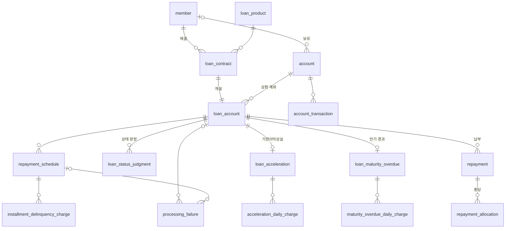

# ERD

스키마의 정본은 `src/main/resources/db/migration/`의 Flyway 마이그레이션이다.
컬럼 상세는 [table_definition.md](./reference/table_definition.md)를 참고한다.

## 테이블 목록

| 구분 | 테이블 | 한글명 |
|---|---|---|
| 회원·계좌 | `member` | 회원 |
| | `account` | 계좌 (`member_id`가 NULL이면 은행 수납 계좌) |
| | `account_transaction` | 계좌 거래 기록 |
| 상품·대출 | `loan_product` | 대출상품 |
| | `loan_contract` | 대출계약 |
| | `loan_account` | 대출계좌 |
| | `repayment_schedule` | 상환 스케줄(회차) |
| | `base_rate_history` | 기준금리(KORIBOR 12개월) 이력 |
| 판정·연체 | `loan_status_judgment` | 대출 상태 판정 |
| | `installment_delinquency_charge` | 회차 연체금 (판정 11·21) |
| | `loan_acceleration` | 기한이익상실 (판정 12·13·22·23) |
| | `acceleration_daily_charge` | 기한이익상실 하루 기록 |
| | `loan_maturity_overdue` | 만기 경과 (판정 1) |
| | `maturity_overdue_daily_charge` | 만기 경과 하루 기록 |
| 납부 | `repayment` | 상환 1건 |
| | `repayment_allocation` | 충당 상세 (상환 1건이 대상 하나에 충당한 금액) |
| 일마감 | `daily_closing` | 일마감 실행 기록 |
| | `processing_failure` | 처리 실패 기록 |

코드성 테이블 12개: `interest_type`, `repayment_method`, `loan_status`, `repayment_schedule_status`,
`loan_judgment_status`, `delinquency_status`, `account_status`, `transaction_type`,
`repayment_channel`, `daily_closing_status`, `failure_type`, `repayment_target_type`

- 코드성 테이블의 id는 enum과 1:1로 대응한다. 초기 데이터는 `V1__code_table_data.sql`에 있고, `repayment_target_type`은 `V8__merge_repayment_allocation.sql`에 있다.
- `loan_judgment_status`의 id는 판정 번호와 같다. 십의 자리는 상환 방법(1 만기일시, 2 분할상환), 일의 자리는 단계(1 회차 연체, 2 기한이익상실, 3 기한이익상실 ❻항)이고, 한 자리는 상환 방법과 상관없는 상태다(0 정상, 1 만기 경과 미상환, 2 완제).
- Spring Batch 메타 테이블(`BATCH_*` 9개)은 `V2__spring_batch_schema.sql`이 만든다.

## 관계

- 관계선이 없는 테이블: `base_rate_history`, `daily_closing`
- `repayment_allocation.target_id`는 대상 종류마다 가리키는 테이블이 달라 관계선을 긋지 않았다(FK 없음).
- 코드성 테이블과의 관계는 생략했다.
