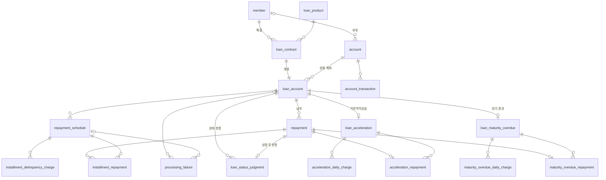

# ERD

스키마의 정본은 `src/main/resources/db/migration/`의 Flyway 마이그레이션이다.
컬럼 상세는 [table_definition.md](./reference/table_definition.md)를 참고한다.

## 테이블 목록

| 구분 | 테이블 | 한글명 |
|---|---|---|
| 회원·계좌 | `member` | 회원 |
| | `account` | 계좌 (`member_id`가 NULL이면 은행 수납 계좌) |
| | `account_transaction` | 계좌 거래 기록 |
| 상품·대출 | `loan_product` | 대출상품 |
| | `loan_contract` | 대출계약 |
| | `loan_account` | 대출계좌 |
| | `repayment_schedule` | 상환 스케줄(회차) |
| | `base_rate_history` | 기준금리 이력 |
| 판정·연체 | `loan_status_judgment` | 대출 상태 판정 |
| | `installment_delinquency_charge` | 회차 연체금 (판정 1·5) |
| | `loan_acceleration` | 기한이익상실 (판정 2·3·6·7) |
| | `acceleration_daily_charge` | 기한이익상실 하루 기록 |
| | `loan_maturity_overdue` | 만기 경과 (판정 4) |
| | `maturity_overdue_daily_charge` | 만기 경과 하루 기록 |
| 납부 | `repayment` | 상환 1건 |
| | `installment_repayment` | 회차 충당 상세 |
| | `acceleration_repayment` | 기한이익상실 충당 상세 |
| | `maturity_overdue_repayment` | 만기 경과 충당 상세 |
| 일마감 | `daily_closing` | 일마감 실행 기록 |
| | `processing_failure` | 처리 실패 기록 |

코드성 테이블 13개: `interest_type`, `repayment_method`, `loan_status`, `repayment_schedule_status`,
`loan_judgment_status`, `judgment_source`, `delinquency_status`, `account_status`, `transaction_type`,
`base_rate_index`, `repayment_channel`, `daily_closing_status`, `failure_type`

- 코드성 테이블의 id는 enum과 1:1로 대응한다. 초기 데이터는 `V1__code_table_data.sql`에 있다.
- `loan_judgment_status`의 id는 판정 번호와 같다(0 정상, 1~7 연체 근거, 8 완제).
- Spring Batch 메타 테이블(`BATCH_*` 9개)은 `V2__spring_batch_schema.sql`이 만든다.

## 관계

- 관계선이 없는 테이블: `base_rate_history`, `daily_closing`
- 코드성 테이블과의 관계는 생략했다.
